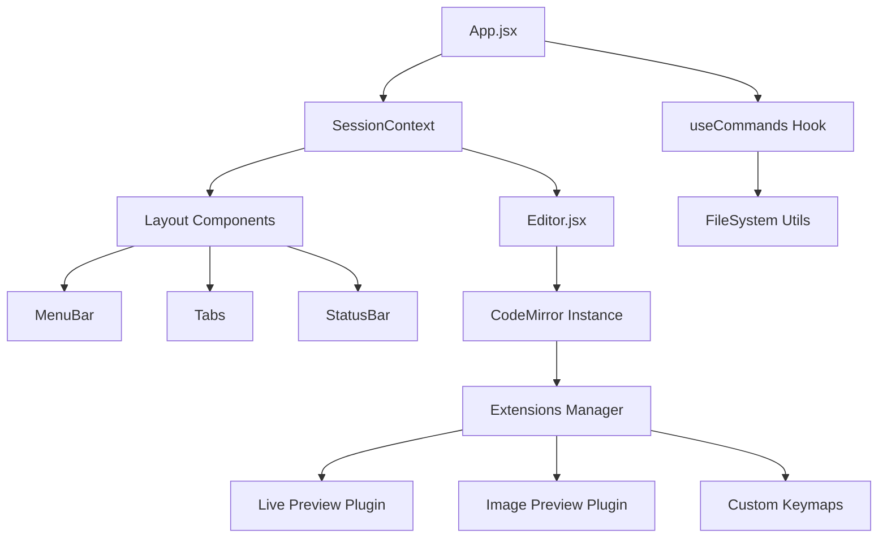

# Architecture Design Document

**Project:** Notepad Flux  
**Last Updated:** 2026-11-17

---

## 1. Introduction

This document outlines the architectural design of **Notepad Flux**, a lightweight, markdown-focused text editor inspired by Windows Notepad but enhanced with modern "Live Preview" capabilities similar to Obsidian.md.

---

## 2. System Overview

The application is a Single Page Application (SPA) built with **React** and **Vite**, utilizing **CodeMirror 6** as the core text editing engine. It runs in modern web browsers and is also packaged as a native desktop application using **Electron** (implemented).

### Key Technologies

- **Frontend Framework**: React 18+/19
- **Build Tool**: Vite
- **Editor Engine**: CodeMirror 6 (@codemirror/view, @codemirror/state, @codemirror/language)
- **Styling**: CSS Modules + Global CSS Variables
- **Icons**: lucide (`lucideSvg.js`)

### Desktop Packaging (Electron)

- Main Process: electron/main.js
- Preload Script: dist-electron/preload.js (built)
- Renderer: dist/index.html (Vite build)
- IPC Channels: read-file, read-file-content, save-file, main-process-message
- Window Integration: custom title bar overlay, mica background (Windows), splash screen
- Installers: Windows NSIS (x64), Linux deb and AppImage via electron-builder

For full desktop packaging details, see Docs/DESKTOP_ELECTRON.md.

---

## 3. High-Level Architecture

The application follows a component-based architecture where the state is managed centrally via React Context (`SessionContext`) and specific editor logic is encapsulated within CodeMirror extensions.

---

## 4. Directory Structure

Directory Structure (key paths):

src/
├── components/             - React UI Components
│   ├── Layout/             - UI Shell (MenuBar, Tabs, StatusBar, etc.)
│   └── Editor.jsx          - Wrapper around CodeMirror instance
├── context/                - React Context for global state
│   └── SessionContext      - Manages tabs, active file, and session data
├── extensions/             - CodeMirror 6 Extensions (The "Brain" of the editor)
│   ├── livePreview.js      - Core WYSIWYG logic (syntax hiding/revealing)
│   ├── widgets.js          - Custom DOM widgets (Checkboxes, Tables, HR)
│   ├── tableCells.js       - Table cell data from the syntax tree + table DOM; also the shared inline renderer for link labels
│   ├── imagePreview.js     - Inline image rendering
│   ├── mathSyntax.js / mathPreview.js     - Math: Lezer parser + shared scanners / widgets
│   ├── footnoteSyntax.js / footnotes.js   - Footnotes: Lezer parser + shared rules / numbering, widgets, tooltip
│   ├── calloutSyntax.js / callouts.js     - Callouts (`> [!type]`): shared scanner + type table / header widgets, fold, tint classes
│   ├── detailsSyntax.js / detailsPreview.js - `
`: region finder over the syntax tree / header widget, fold, body styling
│   ├── mermaidPreview.js   - Mermaid: fenced diagram widget outside the cursor, raw source inside
│   ├── frontMatterSyntax.js / frontMatterPreview.js - Front matter: shared scanner + Lezer block node / Properties box (js-yaml)
│   ├── subSupPreview.js    - Subscript and superscript: `@lezer/markdown` Subscript/Superscript, marks hidden outside the cursor
│   ├── emojiSyntax.js      - Emoji shortcodes: shared `scanEmoji` + lezer node
│   ├── emojiPreview.js     - Emoji widget (`span.cm-emoji`) outside the cursor, raw shortcode inside
│   ├── htmlInlinePreview.js - Safe inline HTML tags (kbd, mark, u, ins, small, abbr, sub/sup, span): tags hidden, content styled outside the cursor
│   ├── entities.js        - Shared HTML entity decoders: `decodeEntity` (small set) serves entity text spans and table-cell Entity nodes; `decodeAttrEntities` (full HTML5 set, via textarea RCDATA) serves abbr titles and link destinations
│   ├── decorationField.js - Shared StateField helpers for decoration fields (`selectionKeyedField`: math, footnotes, subSup, emoji, htmlInline). callouts, mermaid and frontMatter still use their own field (backlog C5)
│   ├── nodeIndex.js       - `nodesOf(state, name)`: one shared tree walk per syntax tree, indexed by node name (see `INDEXED_NODES`), cached on doc + tree
│   └── ...
├── hooks/                  - Custom React Hooks
│   └── useCommands.js      - Centralized command logic (Save, Open, New Tab)
├── styles/                 - Global styles and CSS variables (`calloutExport.css`: callout rules shared by HTML export and Print/PDF)
├── utils/                  - Utility functions
│   ├── fileSystem.js       - Abstraction for File System Access API
│   ├── exportCallouts.js   - marked extension: callout blockquotes to callout markup (factory returns `{ extension, finish }`; `finish(root)` swaps the icon marker for the svg)
│   ├── exportMath.js       - marked extension: math to placeholders (factory returns `{ extension, prepare, has, finish }`; `finish(root)` swaps in MathJax's sanitized SVG)
│   ├── exportFootnotes.js  - marked extension: footnotes (factory returns `{ extension, appendSection, finish }`; `appendSection(m, html)` adds the notes section before sanitizing, `finish(root)` turns marker classes into ids)
│   ├── exportMermaid.js    - marked extension: mermaid fences to nonce placeholders (factory returns `{ extension, prepare, finish, has }`; `finish(root)` swaps each for the sanitized svg)
│   ├── mermaid.js          - `renderMermaid`: serial renders through the frame bridge, FIFO cache, fresh root ids, SVG and CSS sanitizer
│   ├── mermaidBridge.js    - `createMermaidFrame()`: lazy hidden iframe (`mermaid-frame.html`), postMessage protocol, `event.source` checks, 15 s timeout
│   ├── mermaidConfig.js    - `MERMAID_CONFIG`: fixed settings and the `secure` list, shared by the frame and `mermaid.js`
│   ├── exportSubSup.js     - marked inline extensions: `~text~` to ``, `^text^` to ``, same rules as the editor
│   ├── exportEmoji.js      - marked inline extension: known shortcodes to the emoji character, same rules as the editor
│   ├── emojiTable.js       - shortcode name to emoji map, generated by `scripts/gen-emoji-table.mjs` from the gemoji devDependency
│   └── lucideSvg.js        - Builds lucide `<svg>` DOM from icon data (callout icons, chevron); null for an unknown name
├── App.jsx                 - Main application layout and event wiring
└── main.jsx                - Entry point

electron/                   - Electron main-process source (ESM)
└── main.js                 - Creates windows, sets IPC handlers

dist/                       - Vite build output for renderer
└── index.html

dist-electron/              - Built Electron bundles (by Vite/electron plugin)
├── main.js                 - Transpiled main process
└── preload.js              - Preload script (contextBridge)

public/
├── icons/desktop/icon.png  - App icon used by installers/windows
└── loading.html            - Splash screen UI

---

## 5. Core Modules & Logic Flow

### 5.1. Session Management (`SessionContext`)

**Responsibility**: Manages the state of open files (tabs).

- **State**:
  - `tabs`: Array of open file objects `{ id, title, content, fileHandle, isDirty }`.
  - `activeTabId`: ID of the currently visible tab.
  - `recentFiles`: History of recently opened files.

- **Logic**: Provides methods to `createTab`, `closeTab`, `updateTab`, and `switchTab`. It acts as the single source of truth for *what* is open, but not necessarily the *current editor state* (which lives in CodeMirror).

### 5.2. The Editor Engine (`Editor.jsx` & CodeMirror)

**Responsibility**: Handles text editing, rendering, and syntax highlighting.

- **Initialization**: `Editor.jsx` initializes a CodeMirror `EditorView` when a tab becomes active.

- **State Sync**:
  - When the user types, `Editor.jsx` captures changes and updates the `SessionContext` (marking the tab as "dirty").
  - When the active tab changes, `Editor.jsx` saves the current view state (scroll position, history) to a cache and restores the state for the new tab.

### 5.3. Live Preview System (`extensions/livePreview.js`)

**Responsibility**: Implements the "WYSIWYG" feel where markdown syntax is hidden unless the cursor is on it.

- **Mechanism**:
  - Uses a CodeMirror `ViewPlugin` and `StateField`.
  - **`buildDecorations`**: Scans the document for markdown syntax (Bold, Italic, Headings, etc.).
    - **Cursor Detection**: Checks if the user's cursor (`state.selection`) overlaps with a syntax node.
    - **If Overlap**: Renders raw text (reveals syntax).
  - doc/tree change rebuilds everything; selection-only moves re-decorate just the top-level blocks the old or new selection touches (line-widened).

### 5.4. Desktop IPC & File Access

When running under Electron, file operations are routed via IPC to the main process to maintain security boundaries:

- read-file: Opens a native file picker and returns { canceled, filePath, content }.
- read-file-content(filePath): Reads content of a given path.
- save-file({ filePath?, content }): Saves to an existing path or opens Save As when filePath is missing.

The renderer uses the preload script to access typed IPC wrappers (see DESKTOP_ELECTRON.md).

### 5.5. Persistence Paths (Desktop)

- app.getPath('userData') is overridden to a stable per-OS path:
  - Windows: %USERPROFILE%\AppData\LocalLow\Notepad Flux
  - Linux: ~/.config/notepad-flux

This path is used for window/session metadata, crash dumps, and other runtime data where applicable.
    - **If No Overlap**: Replaces syntax with styled `Decoration` (e.g., hides `**`, makes text bold) or replaces the node with a `Widget` (e.g., Checkbox, Horizontal Rule).

- **Widgets**:
  - `CheckboxWidget`: Interactive checkbox that updates the underlying text `[ ]` <-> `[x]` on click.
  - `TableWidget`: Builds the table DOM from data taken from the syntax tree by `tableCells.js` (no HTML string); cells show the same inline features as text outside a table.
  - `ImageWidget`: Renders images inline.

### 5.4. File System Abstraction (`utils/fileSystem.js`)

**Responsibility**: Handles reading and writing files to the user's disk.

- **Strategy**:
  - **Primary**: Uses the modern **File System Access API** (`showOpenFilePicker`, `showSaveFilePicker`) for direct read/write access.
  - **Fallback**: Uses standard HTML `<input type="file">` and `<a>` download attributes for browsers that don't support the API (e.g., Firefox).

### 5.5. Command System (`hooks/useCommands.js`)

**Responsibility**: Bridges the UI (MenuBar, Shortcuts) with the Logic (Context, FileSystem).

- **Flow**:
  1. User clicks "Save" or presses `Ctrl+S`.
  2. `useCommands.saveFile` is triggered.
  3. It checks `SessionContext` for the active tab's `fileHandle`.
  4. If a handle exists, it calls `fileSystem.saveFile`.
  5. If successful, it calls `session.updateTab` to clear the `isDirty` flag.

Global shortcuts are one table in `App.jsx` (`handleKeyDown`), matched on `e.code` (physical key) with exact modifiers, so they work on any keyboard layout and AltGr/Ctrl+Alt never fires them. The `Ctrl+X` labels in `MenuBar.jsx` are display text; keep them in step with the table by hand.

---

## 6. Data Flow Scenarios

### Scenario A: Opening a File

1. **User Action**: Click "Open" in MenuBar.
2. **Command**: `useCommands.openFile()` calls `fileSystem.openFile()`.
3. **File System**: Browser native picker opens -> User selects file -> Returns `{ handle, content, name }`.
4. **Context Update**: `useCommands` calls `session.createTab()` with the new file data.
5. **Editor Update**: `Editor.jsx` detects `activeTabId` change -> Initializes new CodeMirror instance with `content`.

### Scenario B: Editing and Live Preview

1. **User Action**: User types `**Bold**`.
2. **CodeMirror**:
   - Updates internal document state.
   - `livePreview.js` plugin runs `update()`.
   - Detects cursor is *inside* the range.
   - **Render**: Shows `**Bold**` (raw text).
3. **User Action**: User moves cursor away.
4. **CodeMirror**:
   - `livePreview.js` runs `update()`.
   - Detects cursor is *outside*.
   - **Render**: Hides `**`, applies `font-weight: bold` style to "Bold".

---

## 7. Performance & Scalability

### 7.1. Large Session Handling Strategy

**Scale**: High number of tabs (N > 50) or large total session size (>100MB).

**Risks**: Slow application startup, high memory usage (GC pressure), and UI responsiveness issues if all tabs are fully initialized at once.

### 7.2. Mitigation Architecture

#### Light Domain State

The global `SessionContext` is designed to be lightweight:
- **Storage**: Stores only raw text and minimal metadata (file path, dirty status).
- **Avoidance**: Derived structures like ASTs, render caches, or editor view states are excluded from the global state.
- **On-Demand Computation**: Individual editor instances recompute these derived states only when they are initialized or become active.

#### Progressive Session Loading

To optimize startup performance:
1. **Active Tab Priority**: The content of the active tab is loaded and rendered immediately upon startup.
2. **Background Hydration**: Inactive tabs are loaded lazily or "hydrated" in the background using `requestIdleCallback` or low-priority timers.
3. **UI Responsiveness**: The UI shell renders first, ensuring the application feels responsive even if the full session data is still loading in the background.

### 7.3. Large File Handling

CodeMirror 6 is performant, but the `livePreview` regex parsing might need optimization for very large documents:
- **Current**: Regex-based parsing for markdown syntax.
- **Future**: Consider using a proper Lezer parser for better performance with files >10,000 lines.

---

## 8. Future Considerations

### 8.1. Electron Integration

The current architecture is "Electron-ready":
- The `fileSystem.js` module can be extended to use Node.js `fs` module when running in an Electron context.
- Allows for deeper OS integration (native menus, file associations, window management).

### 8.2. Plugin System

The architecture allows for easy addition of new features by simply adding new CodeMirror extensions:
- Extensions are modular and can be enabled/disabled independently.
- Custom extensions can be added to the `extensions/` array in `Editor.jsx`.

---

## 9. Security Considerations

### 9.1. File System Access

- **Permissions**: File System Access API requires explicit user permission for each file/directory.
- **Sandboxing**: Browser security model prevents unauthorized file access.

### 9.2. Content Rendering

- **XSS Prevention**: All user-generated content is rendered through CodeMirror's safe DOM manipulation.
- **Link Safety**: External links open in new tabs with `rel="noopener noreferrer"`.
- **Tag Allowlist**: `sanitize.js` `ALLOWED_TAGS` grows with each safe inline tag (`kbd`, `mark`, `u`, `ins`, `small`, `abbr` added for F7). `ALLOWED_ATTR` stays as is, so no `style` or `on*`.

### 9.3. Local Storage

- **Session Data**: Stored in browser's IndexedDB (origin-isolated).
- **Privacy**: No data is sent to external servers; all processing is client-side.

---

## 10. Extension Architecture

### Core Extensions

The editor's functionality is built through composable CodeMirror extensions:

1. **`livePreview.js`**: Main live preview logic
   - Handles syntax hiding/revealing
   - Manages decorations for all markdown elements
   - Implements activation modes

2. **`widgets.js`**: Widget definitions
   - `BulletWidget`: Bullet point replacement
   - `CheckboxWidget`: Interactive task checkbox
   - `HRWidget`: Horizontal rule
   - `TableWidget`: Rendered table, built from tree data (`tableCells.js`)

3. **`imagePreview.js`**: Image rendering
   - Image loading and caching
   - Broken image handling
   - Active/inactive state management

4. **`linkPreview.js`**: Link rendering
   - Link widget with icon
   - Label rendered from `tableCells.js` parts (`linkLabelParts` + `appendParts`, DOM text nodes), so labels show the same inline features as table cells; labels with no inline-construct character skip the walk
   - Cursor-based activation

5. **`linkHandler.js`**: Link interaction
   - Ctrl+Click to open links
   - Hover tooltip
   - URL extraction from syntax tree

6. **`listKeymap.js`**: List keyboard behaviors
   - Enter key handling
   - Tab/Shift+Tab indentation
   - Task list creation

7. **`tableCells.js`**: Rendered table cells
   - Also a registry: every inline feature that should render in cells and link labels (math, sub/sup, emoji, footnote refs, highlight, HTML tags) needs a case in its `convert()` and `appendParts`.
   - `buildTableData` reads rows/cells/inline parts from the syntax tree (footnote numbers via `resolveFootnotes`); `tableDOM` builds the DOM with `createElement`/`textContent`, no sanitizer pass

8. **`mathSyntax.js`** / **`mathPreview.js`**: Math (`$…$`, `$$…$$`)
   - `mathSyntax.js`: Lezer parser plus the pure scanners shared with HTML export
   - `mathPreview.js`: rendered formula widgets

9. **`footnoteSyntax.js`** / **`footnotes.js`**: Footnotes (`[^label]`, `^[inline]`, `[^label]:`)
   - `footnoteSyntax.js`: Lezer parser, shared scanners and GitHub-order numbering (`numberFootnotes`)
   - `footnotes.js`: `resolveFootnotes`, number widgets, hover tooltip, jump

10. **`calloutSyntax.js`** / **`callouts.js`**: Callouts (`> [!type] Title`, `-`/`+` fold)
   - `calloutSyntax.js`: `scanCallout`, `CALLOUT_TYPES` (canonical types, aliases, icons), `calloutTitle`
   - `callouts.js`: one StateField (header widget, tint line classes, folded-body block replace). Fold state (`flipped`) is view-only: kept in the field, mapped through edits, pruned when its header goes or its fold char changes, never persisted to the document or session. Selection-only transactions keep the previous decorations unless a cursor entered/left a header line or an unfold flipped a callout. `unfoldOnJump` (transaction filter) rewrites a one-line arrow-key step across a folded body to land inside it, which unfolds it.

11. **`mermaidPreview.js`**: Mermaid (`` `mermaid` `` fences)
   - Block widget with the rendered diagram outside the fence; raw source inside it. Click on the diagram puts the cursor in the source (click-to-edit). A theme watcher re-renders visible diagrams when the app theme changes. Uses `utils/mermaid.js` for rendering. Mermaid itself runs only in `mermaid-frame.html` (`src/mermaidFrame.js`), a hidden same-origin iframe with the CSP `default-src 'none'; script-src 'self'; style-src 'unsafe-inline'`, so nothing Mermaid builds from document text can fetch. It is a second Vite build input next to `index.html` and is created on the first render, not at startup.

12. **`frontMatterSyntax.js`** / **`frontMatterPreview.js`**: YAML front matter (a `---` block at offset 0)
   - `frontMatterSyntax.js`: `scanFrontMatter` (the one copy of the rule, shared by the editor and export) and a Lezer block node, so no HR or heading is parsed inside the block.
   - `frontMatterPreview.js`: Properties box widget (parsed with js-yaml) outside the block; raw YAML inside it. Click the box to edit.

13. **`subSupPreview.js`**: Subscript and superscript (`~text~`, `^text^`)
   - Uses `@lezer/markdown`'s own Subscript and Superscript nodes, so no new parser. Outside the cursor the marks are hidden and the text gets `cm-subscript` / `cm-superscript`.

14. **`emojiSyntax.js`** / **`emojiPreview.js`**: Emoji shortcodes (`:name:`)
   - `emojiSyntax.js`: `scanEmoji` (the one copy of the rule, shared by the lezer node and the export) and the lezer node.
   - `emojiPreview.js`: `span.cm-emoji` widget showing the character outside the cursor; raw shortcode inside.

15. **`htmlInlinePreview.js`**: Safe inline HTML tags (`<kbd>`, `<mark>`, `<u>`, `<ins>`, `<small>`, `<abbr>`, ``, ``, ``)
   - Pairs the opening and closing `HTMLTag` nodes in the same inline context. Outside the cursor the tags are hidden and the content gets a class; attributes are never applied, except `abbr` `title`, which becomes the tooltip. Block HTML and ` ` stay source.

16. **`detailsSyntax.js`** / **`detailsPreview.js`**: Collapsible `
` blocks
   - `detailsSyntax.js`: `findDetails`, region finder over the syntax tree (document-level `HTMLBlock`s, nesting, label, `open`)
   - `detailsPreview.js`: StateField modelled on `callouts.js` (header widget, body/end line classes, folded block replace, view-only fold flips, `unfoldOnJump`); fold machinery is duplicated, not shared

Export: one module per feature in `src/utils/` follows one contract, `createX(...) → { extension, prepare?, has?, finish(root) }` (stateless features, `exportSubSup.js` and `exportEmoji.js`, export the marked extension object directly, with no `createX`/`finish`), and `export.js` `renderMarkdownHtml` composes them, sanitizes, then runs each `finish(root)` (the post-sanitize DOM pass): math (after `prepare`), footnotes (ids; its `appendSection` runs before sanitizing), callouts (icons) and mermaid (SVG). Sanitizing lives in `sanitize.js`, plus the SVG sanitizers in `math.js` and `mermaid.js` (MathJax/Mermaid output is inserted after `sanitizeHTML`). Each feature owns its own swap, so `export.js` doesn't grow a block per feature. Mermaid SVG is inserted after sanitizing, from `mermaid.js`, which runs its own SVG sanitize. `renderMarkdownHtml(md, { expandFolds })` renders every fold open (PDF/Print). It strips front matter before marked lexes the document. `sanitize.js` allows `div`/`details`/`summary`/`open` for every caller (TableWidget too), not just export. Rules are shared with the editor via `src/extensions/*Syntax.js`; sub/sup is the exception: the editor uses lezer's built-in Subscript/Superscript and export mirrors them with `scanSubSup` in `src/utils/exportSubSup.js`, kept in step by the shared case table `src/test/subSupCases.js`.

---

*This document is maintained alongside the codebase and should be updated when significant architectural changes are made.*
