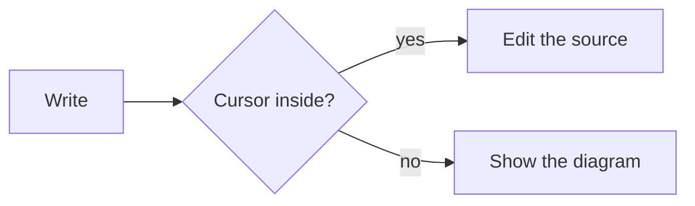
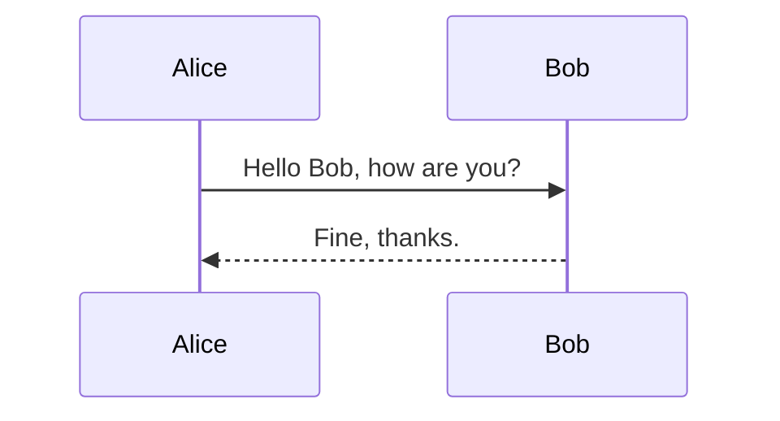

# Markdown Reference Guide

**Project:** Notepad Flux  
**Last Updated:** 2026-11-17

---

This reference guide provides a comprehensive overview of the Markdown syntax supported in Notepad Flux. All examples shown here will render correctly in the Live Preview mode.

---

## Table of Contents

1. [Headers](#headers)
2. [Emphasis](#emphasis)
3. [Lists](#lists)
4. [Links](#links)
5. [Code](#code)
6. [Tables](#tables)
7. [Blockquotes](#blockquotes)
8. [Horizontal Rules](#horizontal-rules)
9. [Line Breaks](#line-breaks)
10. [Task Lists](#task-lists)
11. [Highlights](#highlights)
12. [Math](#math)
13. [Footnotes](#footnotes)
14. [Callouts](#callouts)
15. [Diagrams (Mermaid)](#diagrams-mermaid)
16. [Front matter (Properties)](#front-matter-properties)
17. [Subscript and superscript](#subscript-and-superscript)
18. [Emoji shortcodes](#emoji-shortcodes)

---

## Headers

```markdown
# H1
## H2
### H3
#### H4
##### H5
###### H6

Alternatively, for H1 and H2, an underline-ish style:

Alt-H1
======

Alt-H2
------
```

**Renders as:**

# H1

## H2

### H3

#### H4

##### H5

###### H6

Alternatively, for H1 and H2, an underline-ish style:

Alt-H1
======

Alt-H2
------

---

## Emphasis

```markdown
Emphasis, aka italics, with *asterisks* or _underscores_.

Strong emphasis, aka bold, with **asterisks** or __underscores__.

Combined emphasis with **asterisks and _underscores_**.

Strikethrough uses two tildes: ~~scratch this~~.
```

**Renders as:**

Emphasis, aka italics, with *asterisks* or _underscores_.

Strong emphasis, aka bold, with **asterisks** or __underscores__.

Combined emphasis with **asterisks and _underscores_**.

Strikethrough uses two tildes: ~~scratch this~~.

---

## Lists

### Unordered Lists

```markdown
* Unordered list can use asterisks
- Or minuses
+ Or pluses
  - Nested item (2 spaces)
    - Double nested (4 spaces)
```

**Renders as:**

* Unordered list can use asterisks
- Or minuses
+ Or pluses
  - Nested item (2 spaces)
    - Double nested (4 spaces)

### Ordered Lists

```markdown
1. First ordered list item
2. Another item
   1. Ordered sub-list
3. Actual numbers don't matter, just that it's a number
4. And another item.
```

**Renders as:**

1. First ordered list item
2. Another item
   1. Ordered sub-list
3. Actual numbers don't matter, just that it's a number
4. And another item.

### List Paragraphs

```markdown
1. You can have properly indented paragraphs within list items.
   
   Notice the blank line above, and the leading spaces.

2. To have a line break without a paragraph, use two trailing spaces.  
   Note that this line is separate, but within the same paragraph.
```

**Renders as:**

1. You can have properly indented paragraphs within list items.
   
   Notice the blank line above, and the leading spaces.

2. To have a line break without a paragraph, use two trailing spaces.  
   Note that this line is separate, but within the same paragraph.

---

## Links

```markdown
[I'm an inline-style link](https://www.google.com)

[I'm an inline-style link with title](https://www.google.com "Google's Homepage")

[You can use numbers for reference-style link definitions][1]

URLs in angle brackets will automatically get turned into links: 
<http://www.example.com>

[1]: https://www.example.com
```

**Renders as:**

[I'm an inline-style link](https://www.google.com)

[I'm an inline-style link with title](https://www.google.com "Google's Homepage")

[You can use numbers for reference-style link definitions][1]

URLs in angle brackets will automatically get turned into links: 
<http://www.example.com>

[1]: https://www.example.com

---

## Code

### Inline Code

```markdown
Inline `code` has `back-ticks around` it.
```

**Renders as:**

Inline `code` has `back-ticks around` it.

### Code Blocks

#### 4-Spaces Fence

```markdown
    s = "Code with space indent"
    print s
```

**Renders as:**

    s = "Code with space indent"
    print s

#### Backtick Fence

````markdown
```
Code goes here
Code goes here
```
````

**Renders as:**

```
Code goes here
Code goes here
```

#### Backtick Fence with Language

````markdown
```javascript
function greet(name) {
  console.log(`Hello, ${name}!`);
}
```
````

**Renders as:**

```javascript
function greet(name) {
  console.log(`Hello, ${name}!`);
}
```

---

## Tables

```markdown
| Tables        | Are           | Cool  |
| ------------- |:-------------:| -----:|
| col 3 is      | right-aligned | $1600 |
| col 2 is      | centered      |   $12 |
| zebra stripes | are neat      |    $1 |
| inline        | $x^2$ H~2~O   | :tada: |
```

**Renders as:**

| Tables        | Are           | Cool  |
| ------------- |:-------------:| -----:|
| col 3 is      | right-aligned | $1600 |
| col 2 is      | centered      |   $12 |
| zebra stripes | are neat      |    $1 |
| inline        | $x^2$ H~2~O   | :tada: |

In the editor, table cells show inline math, subscript and superscript, emoji shortcodes, footnote numbers and `==highlight==` the same way they show outside a table. Click the table to edit its source.

In the editor, only web and email links in cells are clickable, the same as outside tables.

### Simple Table

You don't need to make the raw markdown line up prettily:

```markdown
Markdown | Less | Pretty
--- | --- | ---
*Still* | `renders` | **nicely**
1 | 2 | 3
```

**Renders as:**

| Markdown | Less      | Pretty     |
| -------- | --------- | ---------- |
| *Still*  | `renders` | **nicely** |
| 1        | 2         | 3          |

---

## Blockquotes

```markdown
> Blockquotes are very handy for emphasizing text.
> This line is part of the same quote.

Quote break.

> This is a very long line that will still be quoted properly when it wraps.
> You can *put* **Markdown** into a blockquote.
```

**Renders as:**

> Blockquotes are very handy for emphasizing text.
> This line is part of the same quote.

Quote break.

> This is a very long line that will still be quoted properly when it wraps.
> You can *put* **Markdown** into a blockquote.

---

## Horizontal Rules

Three or more...

```markdown
---

Hyphens

***

Asterisks

___

Underscores
```

**Renders as:**

---

Hyphens

***

Asterisks

___

Underscores

---

## Line Breaks

```markdown
Here's a line for us to start with.

This line is separated from the one above by two newlines, so it will be a *separate paragraph*.

This line is also a separate paragraph, but...  
This line is only separated by two trailing spaces and a single newline, so it's a separate line in the *same paragraph*.
```

**Renders as:**

Here's a line for us to start with.

This line is separated from the one above by two newlines, so it will be a *separate paragraph*.

This line is also a separate paragraph, but...  
This line is only separated by two trailing spaces and a single newline, so it's a separate line in the *same paragraph*.

---

## Task Lists

```markdown
- [x] Completed task
- [ ] Incomplete task
- [ ] Another incomplete task
  - [x] Nested completed task
  - [ ] Nested incomplete task
```

**Renders as:**

- [x] Completed task
- [ ] Incomplete task
- [ ] Another incomplete task
  - [x] Nested completed task
  - [ ] Nested incomplete task

**Note:** In Notepad Flux, you can click on the checkboxes to toggle their state!

---

## Highlights

```markdown
This is ==highlighted text== for emphasis.

You can combine ==**bold highlighted**== text.
```

**Renders as:**

This is ==highlighted text== for emphasis.

You can combine ==**bold highlighted**== text.

---

## Math

LaTeX math, rendered with MathJax (the engine Obsidian uses). Put the cursor inside a formula, or click it, to edit the TeX.

```markdown
Inline: the area is $\pi r^2$.

Display on its own lines:

$$
\int_0^1 x^2\,dx = \frac{1}{3}
$$

Display inside a line: $$e^{i\pi} + 1 = 0$$
```

Rules:

- `$` opens a formula only when the next character isn't a space, and closes at a `$` with no space before it and no digit after it. So `costs $5 and $10` stays plain text.
- `\$` is a literal dollar sign.
- A `$$` line with no closing `$$` further down stays plain text.
- Math inside code spans and code blocks is never rendered.
- Supported packages: AMS math, `\newcommand` (inside one formula), `\boldsymbol`, `\color`, `\cancel`, `\ce` (chemistry, mhchem) and `\bra`/`\ket` (braket). Links and raw HTML in TeX (`\href`, `\style`) are not supported.
- HTML export, PDF export and Print render math too.

---

## Footnotes

A labelled reference points to a note defined elsewhere in the document. Inline footnotes put the note text right where it is used.

```markdown
The sky is blue.[^sky]

Water is wet.^[Its own note, with *emphasis* and `code` allowed.]

[^sky]: Rayleigh scattering of sunlight.

    A second paragraph of the same note, indented 4 spaces.
```

Rules:

- `[^label]` is a reference only when a `[^label]: text` definition with the same label exists. Otherwise it stays as typed. Labels are not case-sensitive and cannot contain spaces.
- Notes are numbered 1, 2, 3… like GitHub: first the references and inline notes in the body, in order; then those inside notes, taking the notes in number order. Labelled and inline notes share one sequence. A note referenced twice keeps its number.
- A note mentioned only inside a note nothing references is not numbered or exported either.
- Inside link text, a note exports as a plain superscript number, not a link; the note itself is still listed.
- A definition that nothing references is not shown in HTML export, PDF export or Print. It stays visible in the editor.
- Inline `^[…]` needs no definition. Its text can hold emphasis, code, links and math, but not block content. Brackets inside it must be balanced, and an empty `^[]` is not a note.
- Footnotes inside code spans, code blocks and math are not rendered.
- GitHub shows inline `^[…]` as plain text. Use `[^label]` for files that will be shown on GitHub.

In the editor:

- A reference shows as a small superscript number. Hover over it to read the note. Ctrl+click moves the cursor to the note text. Ctrl+click the `[^label]:` marker of a note to jump back to its first reference.
- Put the cursor on a reference, or click it, to see and edit the raw `[^label]`.
- An inline note shows as one superscript number. Hover shows its text. Click it to edit the raw `^[…]`.
- Limit: a reference inside a table cell stays as raw text. Ctrl+click jumps only from the rendered number, not from raw text.

---

## Callouts

A callout is a blockquote whose first line names a type in square brackets, such as `[!note]`. It draws a coloured box with an icon and a title. GitHub's alerts (`[!NOTE]`, `[!TIP]`, `[!IMPORTANT]`, `[!WARNING]`, `[!CAUTION]`) render the same way.

```markdown
> [!note]
> The title is the type name, "Note".

> [!warning] Back up first
> The body can hold *Markdown*, links and lists.

> [!tip]- Hidden until clicked
> A `-` after the type starts the callout folded.

> [!faq]+ Open by default
> A `+` starts it open, and it can still be folded.

> [!info] Outer callout
> > [!bug] Nested callout
> > Callouts nest like blockquotes.
```

Rules:

- The type must be the first thing after the `>`. The type is letters, digits, `-` or `_` (up to 50 characters), and is not case-sensitive.
- The title is the rest of the first line, after one space. It can hold inline Markdown. With no title, the title is the type as written, with its first letter capitalised: `[!faq]` shows "Faq", `[!WARNING]` shows "Warning".
- A callout can be just the header line, with no body.
- Callouts work inside list items, like blockquotes do.
- These are not callouts: `[!type]` anywhere but the first line, `> text [!note]`, `\[!note]`, and anything inside a code span or code block.

Types. The canonical name sets the colour and icon. Aliases are other names for the same type:

| Type | Aliases |
|---|---|
| `note` | |
| `abstract` | `summary`, `tldr` |
| `info` | |
| `todo` | |
| `tip` | `hint` |
| `important` | |
| `success` | `check`, `done` |
| `question` | `help`, `faq` |
| `warning` | `attention` |
| `caution` | |
| `failure` | `fail`, `missing` |
| `danger` | `error` |
| `bug` | |
| `example` | |
| `quote` | `cite` |

An unknown type, such as `[!idea]`, shows the note colour and icon, with its name as the title.

In the editor:

- The callout has a tinted background and a coloured left border. Its body stays editable as normal text, with the usual live preview.
- When the cursor is off the header line, the `[!type]` marker is replaced by the callout's icon and title. Put the cursor on the header to see and edit the raw `[!type]`.
- A foldable callout (`-` or `+`) shows a chevron on its header. Click the chevron to fold or unfold it.
- Folding is view-only. It never changes the document and is not kept between sessions. Moving the cursor into a folded body (with search, Go to line or the arrow keys) unfolds it.

Export:

- HTML export keeps the callout's folds. A `-` callout is closed in the file, and the reader can open it.
- PDF export and Print open every foldable callout, because a page can't be clicked.

---

## Diagrams (Mermaid)

A fenced code block whose language is `mermaid` draws a diagram, with Mermaid. Flowcharts, sequence diagrams and the other Mermaid diagram types work.

````markdown



````

Rules:

- The fence can be backticks or tildes, of any length. The language word is not case-sensitive.
- With the cursor outside the block, the diagram replaces the whole block. Click the diagram to edit its source. The cursor goes to the first line of the source.
- With the cursor inside the block, you see only the source. There is no preview while you edit. The diagram comes back when the cursor leaves the block.
- The diagram follows the app's light or dark theme. HTML export, PDF export and Print always use the light theme.
- A syntax error shows Mermaid's message in a box, in place of the diagram.
- Works offline. Mermaid is bundled with the app. It loads the first time a diagram appears, so a document without diagrams never loads it.
- For safety, links you click in a diagram are off, and HTML labels are off. Diagrams are drawn in an isolated hidden page that can't load anything from the network or disk, so a diagram can't contact the network. A web address in a label is just text. A `%%{init}%%` line or front matter config in the document can't change the theme, the look or the styles.
- Syntax reference: [mermaid.js.org syntax docs](https://mermaid.js.org/intro/syntax-reference.html).

---

## Front matter (Properties)

A YAML block at the very top of the file, between two `---` lines, is front matter. With the cursor outside the block, it shows as a Properties box. The box lists one row per key.

````markdown
---
title: Trip notes
date: 2026-11-17
tags: [travel, family]
---
````

Rules:

- The first line of the file must be `---`. The block ends at the next line that is `---` or `...`.
- Lists show as chips. Dates show exactly as written. Nested values show as compact YAML.
- An empty block shows "No properties".
- Invalid YAML shows the error and the raw text.
- Click the box, or move the cursor into it, to edit the raw YAML.
- A `---` anywhere else is a horizontal rule, as before.
- HTML export, PDF export and Print leave front matter out.
- Known limits: keys that are whole numbers (`1:`, `2:`) are listed first. A block with more than 500 lines between the `---` lines is not front matter (the editor and export treat it as normal text).

---

## Subscript and superscript

Write `~text~` for subscript and `^text^` for superscript.

```markdown
Water is H~2~O, and x^2^ is x squared.

Use a backslash for a space: H~a\ b~.
```

**Renders as:**

Water is H~2~O, and x^2^ is x squared.

Use a backslash for a space: H~a\ b~.

Rules:

- The text can't hold a plain space. Write `\ ` for a space.
- The text isn't formatted further. `~*a*~` shows the asterisks.
- `~~text~~` is still strikethrough.
- A single `~text~` used to export as strikethrough. It now exports as subscript. Use `~~text~~` for strikethrough.
- `^[note]` is still an inline footnote, not a superscript.
- Subscript and superscript don't work inside code or math.

---

## Emoji shortcodes

Write a name between colons to get an emoji.

```markdown
Shipped it :tada: Thanks :+1:
```

**Renders as:**

Shipped it :tada: Thanks :+1:

Rules:

- Names are GitHub's, about 1,900 including aliases. `:smile:`, `:+1:` and `:tada:` all work.
- Unknown names stay as typed.
- A letter or digit right before or after the colons blocks it. So `12:100:45` and `a:smile:b` stay as typed.
- Not inside code, math, link addresses or front matter.
- With the cursor outside the shortcode, you see the emoji. Put the cursor on it to see the raw text.
- HTML export, PDF export and Print write the emoji character.

---

## Images

```markdown


Inline-style:


Reference-style:
![alt text][logo]

[logo]: https://via.placeholder.com/150 "Logo Title"
```

**Note:** Images will be displayed inline in Notepad Flux when not actively editing the markdown syntax.

---

## Comments

You can add comments that won't appear in the preview:

```markdown
[comment]: # (This is a comment and won't be visible)
```

---

## Escaping Characters

Use backslash to escape markdown characters:

```markdown
\*This text is not italic\*
\# This is not a heading
\[This is not a link\]
```

**Renders as:**

\*This text is not italic\*  
\# This is not a heading  
\[This is not a link\]

---

## Keyboard Shortcuts

While editing in Notepad Flux:

- **Enter** in a list: Create a new list item
- **Enter** on an empty list item: Exit the list
- **Tab** in a list: Indent (nest) the item
- **Shift+Tab** in a list: Unindent the item
- **Ctrl+Click** on a link: Open the link in a new tab

---

## Best Practices

### Readability

1. **Use blank lines** between different block elements (headers, paragraphs, lists)
2. **Indent nested lists** with 2 or 4 spaces consistently
3. **Use descriptive link text** instead of "click here"
4. **Add alt text to images** for accessibility

### Compatibility

1. **Stick to standard markdown** for maximum compatibility
2. **Test special features** (like task lists and highlights) if exporting
3. **Use fenced code blocks** (with backticks) instead of indented code blocks for better language support

### Organization

1. **Use headings hierarchically** (don't skip levels)
2. **Use tables** for structured data
3. **Use blockquotes** for quotations or callouts
4. **Use horizontal rules** sparingly to separate major sections

---

## Cross-References

- For details on how these elements render in Live Preview, see [`FEATURES.md`](./FEATURES.md)
- For styling details, see [`DESIGN_SYSTEM.md`](./DESIGN_SYSTEM.md)

---

*This reference guide is based on standard Markdown syntax with some extensions supported by Notepad Flux.*

**Credits:**
- Original inspiration: [Markdown Cheatsheet by Adam Pritchard](https://github.com/adam-p/markdown-here/wiki/Markdown-Cheatsheet)
- License: [CC-BY](https://creativecommons.org/licenses/by/3.0/)
